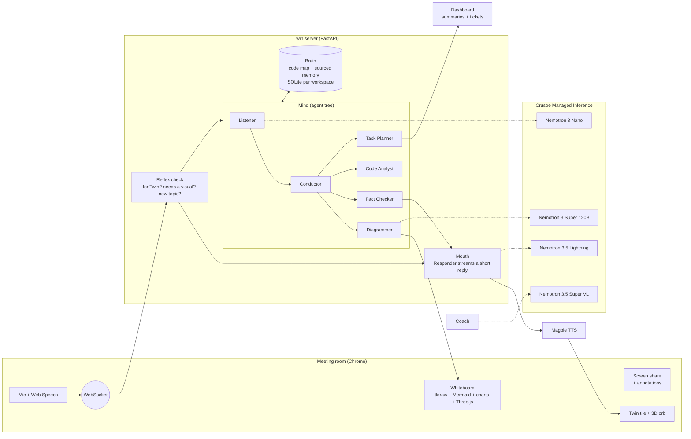
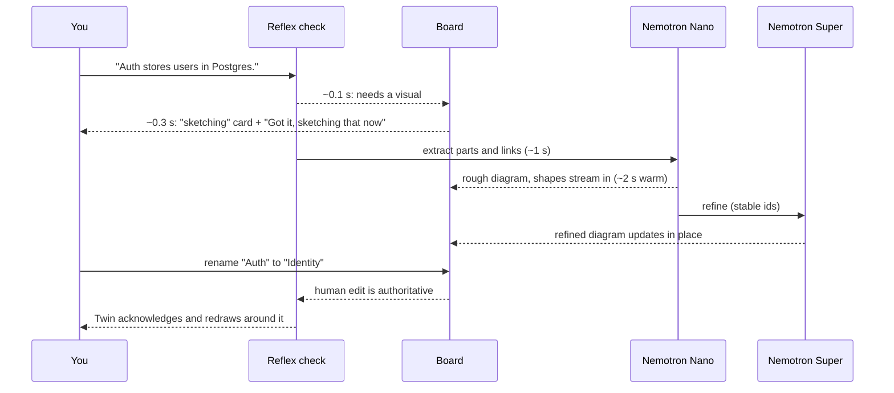
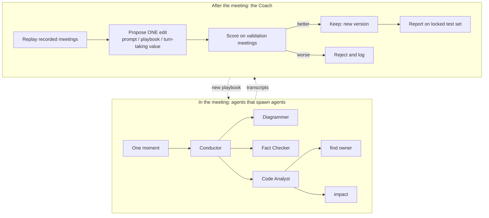

# Twin

## ▶ Try it live: **[crusoehacks.vercel.app](https://crusoehacks.vercel.app)**

## 🎬 Watch the 60s launch video: **[twin-launch-60s-music.mp4](docs/media/twin-launch-60s-music.mp4)**

Open the link, sign in to a workspace, start a meeting, and talk to Twin. Backend: Railway (`twin-backend-production-32eb.up.railway.app`), all reasoning on NVIDIA Nemotron via Crusoe.

**A teammate that joins your meeting, talks, draws, knows your code, and gets better every time.**

Twin is not a note-taker. Note-takers remember your meetings. Twin takes part in them. It joins the call with its own tile and voice, sketches the architecture while you talk, checks what people say against the real repo, turns decisions into tickets, and after every meeting a Coach proposes changes to Twin and keeps only the ones that score better on meetings it has never seen.

Built in one day at the **Recursive Agents Hackathon** (Cerebral Valley x Crusoe, Shack15 SF, Oct 17 2026).
**Track: Version N+1** (Twin improves itself, measured). Also touches Shared Brain (one memory of code and decisions for the whole team).
Every thinking call runs on **open NVIDIA Nemotron models via Crusoe Managed Inference**.

| | |
|---|---|
| Talks | Real voice (NVIDIA Magpie TTS). Waits its turn, stops when you talk over it |
| Draws | Boxes and arrows, Mermaid sequence diagrams, charts, tables, UI mockups, 3D scenes, live on a shared whiteboard |
| Knows your code | Connect a GitHub repo once per company. Twin maps files, owners and impact |
| Checks | Flags claims the code contradicts, citing the file and lines |
| Ships work | Meeting end: summary, decisions, to-dos and tickets on the dashboard |
| Learns | Coach edits Twin's prompts and turn-taking rules, scores them on held-out meetings, keeps only wins |

---

## How it works



**Mouth and mind.** The mouth never waits for the mind. You get a short spoken reply in about a second while the mind draws, checks the code and writes tasks in parallel. The mind's results are spoken at the next natural pause ("I sketched that, does it look right?").

### From your sentence to a diagram



Speed rules: one model call per drawing burst, newest sentence wins (stale work is cancelled), instant acknowledgement, rough first then refine.

### Where the recursion is (Version N+1)



- Run time: the Conductor splits a moment into jobs, jobs can spawn sub-jobs (depth 3, max 12). The tree is visible live in the side panel.
- Learning: 12 scripted meetings (8 train, 2 validation, 2 locked test). Every Coach edit is logged with its score, kept or rejected.
- First real Coach run today: candidate edit scored F1 0.40 vs v1 0.60 on validation, so it was **rejected automatically**. Evidence: `server/learning/results/coach_prep_iteration_2026-10-17.json`. We report rejections; we do not claim gains we did not measure.

---

## How hard we pushed the models

We did not just call one model. Each Nemotron model got the job it is best at, and we measured where each one breaks.

```mermaid
xychart-beta
  title "Before vs after tuning (seconds, lower is better)"
  x-axis ["Understand a sentence", "First sound", "Diagram on board"]
  y-axis "seconds" 0 --> 24
  bar [12, 2.7, 24]
  bar [0.97, 0.016, 2.09]
```



| Model | What we pushed | What we found and changed |
|---|---|---|
| Nemotron 3 Nano 30B (Listener, reflex fallback) | Every sentence of a live meeting | Reasoning-heavy replies hit 1,500 to 1,600 output tokens and took 9 to 12 s. A compact no-thinking extraction prompt brought the median to 965 ms (5 live calls) |
| Nemotron 3 Super 120B (Diagrammer, router, code analyst) | One call that plans a WHOLE diagram as validated JSON ops, plus 3D part plans | Empty or partial plans were sometimes accepted as success: now every plan is validated before drawing, with one repair retry. A 3D robot arm came back as 7 connected named parts with exactly 3 joints, but took 24.6 s, so 3D runs off the critical path |
| Nemotron 3.5 Lightning 30B (spoken reply) | Fastest first token | Returns "capacity unavailable" (503) under load; Twin falls back to Nano automatically |
| Nemotron 3.5 Super VL (Coach, screen reading) | Judging Twin's own edits on held-out meetings | Three real Coach trials so far: one scored worse (0.40 vs 0.60), two tied; all three were rejected and v1 stayed active |
| NVIDIA Magpie TTS | Sentence-by-sentence streaming voice | 1 to 2.5 s per call; free tier returns 429 after about 3 rapid calls. Added backoff, a phrase cache, and a pre-made 16 ms acknowledgement |

Speed tricks that came out of this: one model call per drawing burst, rough draw on the fast model then refine on Super, newest sentence cancels stale work, reflex check (~0.1 s) gates everything.

**Head-to-head, 76 real calls on Crusoe** (from `BENCHMARKS.md`, failures and timeouts kept in the denominator):

| Model | Extraction F1 (12 meetings) | Fact check caught | 3D plan valid | Extraction p50 |
|---|---|---|---|---|
| Lightning | 0.43 | 2/2 | 0/1 | 662 ms |
| Nano | 0.49 | 2/2 | 1/1 | 1028 ms |
| Super | 0.53 (8/12 answered in time) | 1/2 | no answer in time | 1486 ms |
| Super-VL | **0.77** | 2/2 | 0/1 | 1090 ms |

Small samples (N shown in `BENCHMARKS.md`), but they already changed our routing: Super is too slow for the live path under an 8 s bound, Nano is the only model that produced a valid 3-joint 3D scene, and Super-VL extracts best.

**System speed (Chrome, N=5, live server):** page load to join screen 231 ms median, Join to connected 669 ms, Join to Twin's 3D orb on screen 868 ms. Reproduce: `cd web && npx playwright test tests/timing.spec.ts`.

Full per-model numbers (accuracy, p50/p95 latency, tokens, startup times, raw JSON): **`BENCHMARKS.md`**.

Tests exist too (436 server tests, a 12-step live spoken script, Playwright browser tests), but the point is the measurements above.

## You stay in control

Built after judge feedback this afternoon; check `TASKS.md` and `AGENT_CHAT.txt` for what landed before the deadline.

Built after judge feedback this afternoon; check `TASKS.md` and `AGENT_CHAT.txt` for what landed before the deadline.

- **Modes:** Off, On request (only when named), Proactive. The board stays hidden until it has content.
- **Permissions per company:** internet off, repo read-only, tickets and screen reading ask first, speaking unprompted off. The server refuses tools that are switched off.
- **Edit it yourself:** draw, rename, annotate on the board or on a shared screen. Human edits win; Twin reacts to them.
- **Echo guard:** Twin never treats its own voice as a person speaking.

## Companies, dashboard, memory

- **Login:** company workspace + invite code (set in `server/.env` as `WORKSPACES=name:code`). Each company only sees its own rooms.
- **Dashboard** (`/dashboard`): today's meetings with Join and auto-join, GitHub repo connected once and remembered, past meetings with summary, decisions, to-dos and tickets, and Twin's learning scores.
- **Memory:** SQLite per workspace (gitignored). Decisions are stored with who said them and when; newer decisions replace older ones.
- **Install as an app:** Chrome "Install Twin" opens it in its own window (PWA).

## Models

| Job | Model on Crusoe |
|---|---|
| Spoken reply | `nvidia/Nemotron-3.5-Lightning-30B-A3B` (fallback Nano) |
| Listen to every line, reflex decisions | `nvidia/NVIDIA-Nemotron-3-Nano-30B-A3B` |
| Draw, route, analyze code, refine | `nvidia/NVIDIA-Nemotron-3-Super-120B-A12B` |
| Coach, read the shared screen | `nvidia/NVIDIA-Nemotron-3.5-Super-VL` |
| Voice | NVIDIA Magpie TTS (multilingual) |

Model ids live only in `server/config.py`. All calls go through `server/llm.py`.

---

## Run it

```bash
# server
cd server
python3 -m venv .venv && .venv/bin/pip install -r requirements.txt
cp .env.example .env        # add CRUSOE_API_KEY, NVIDIA_API_KEY (+ optional WORKSPACES). Never commit .env
.venv/bin/uvicorn app:app --host 0.0.0.0 --port 8000

# web (second terminal)
cd web && npm install && npm run dev
```
Open **http://localhost:5173/dashboard** in Chrome, log in, click Join. Use headphones. Full guide and troubleshooting: `RUNNING.md`. No keys? `http://localhost:5173/room/demo?mock=1` plays a scripted meeting.

**Public link:** `cloudflared tunnel --url http://localhost:8000`, deploy `web/` to Vercel with `VITE_SERVER_URL=wss://<tunnel>` (or append `?server=wss://<tunnel>` to the link).

**Two laptops:** same Wi-Fi: `npm run dev -- --host` on laptop A, laptop B opens `http://<A-ip>:5173`. Otherwise use the tunnel.

## Repo map

```
server/            FastAPI app, WebSocket session, mouth, turn-taking, voice
  agents/          listener, conductor, diagrammer, fact checker, code analyst, task planner, responder, reflex
  brain/           code map, sourced memory, GitHub repo connector
  learning/        replay harness, evaluate, Coach, results (committed evidence)
  scripts/         smoke tests, live end-to-end script
  tests/           pytest suite + golden draw ops
web/               React + Vite meeting room, whiteboard, dashboard, login
demo_project/      small sample codebase Twin reasons about in the demo
ARCHITECTURE.md    full design    PROTOCOL.md  browser <-> server contract
TASKS.md, AGENT_CHAT.txt          how three coding agents built this in parallel
```

## How we built it

Two humans and three coding agents (two Claude, one Codex) worked in parallel on one repo, coordinating through `TASKS.md` and an append-only `AGENT_CHAT.txt`, with a shared contract in `PROTOCOL.md` and code ownership by area. The 3D part planning borrows the architecture of Preet's earlier project [LoominPhysicsSandbox](https://github.com/Preet37/LoominPhysicsSandbox) (structural part plans with real sizes, deterministic validation before drawing).

Team: Preet Karia, Parsh Gandhi.
